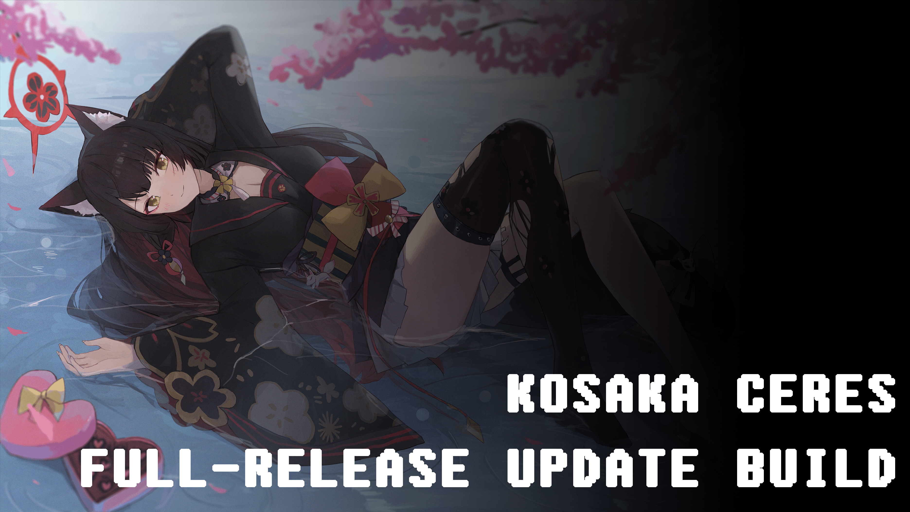

# Mover's Stability Update (v2.4.11)
Well it's been a long time. Originally this version was supposed to release ages ago under the "v2.5.X" versions, featuring a WPlace Grief detector but I never got around to it unfortunately because I was (and still is) drowning in legal documents right now as for those unaware, I'm moving out extremely soon into a completely different region to go to college for the first time. It's not been a smooth experience at all, I have like 1 week left to find and get an apartment but I CANT BLOODY GET THE DOCUMENTS I NEED IN TIME CAUSE PEOPLE ARE SLOW GAH-  
Anyways this isn't the place to rant, here's one last stability update for the v2.4.X versions hopefully, after that we're going straight back into feature updates! (And boy do I have a lot planned, though I might have to do other things first before that...)  
Well er technically with the new Embeds this is a feature update but fuck it.

# General Changes
- Updated manually certain frameworks used by Kosaka, which should fix some extremely strange issues such as connecting to a voice chat being ungodly unreliable.
- We're now using an experimental logging system to try to catch more errors, as the previous system for some reason never logged any errors.

# Core Modules
## Modules
- Modules can now be reloaded anywhere, this speeds up development much faster.

# Extended Modules
## Archiver
### Loggers
- Fixed an odd, rare issue related to embeds.

## Charm
### Welcomer
- Fixed an issue where Kosaka wouldn't be able to send an embed because Kosaka hasn't logged when a user joined the server.
- Fixed a bug due to bad async coding (I FUCKING HATE ASYNC)

## Utility
### Embed Fixer
- Fixed an issue where YouTube Embeds wouldn't work if the video has no tags.
- Fixed fuckery that happened if Kosaka tried to fix herself ~~(she never will be able to on her own)~~. This is a bug exclusive to the `/echo` command.
- Fixed `/embed_fixer` not working.
- Fixed an issue with YouTube Links containing extra data in the URL.
- Fixed poor Twitter Profile Regex.
- **Upgraded Twitter Embeds to Components V2: Videos are now DIRECTLY inside the "Embed"!**
*This change will be backported to all other types of Embeds that Kosaka fixes after it is deemed that the new Embed System works without any issues.*

## Music
- KMDS 1.2.0: Fixed issues with certain song names causing Kosaka to get really confused as to if the song was downloaded or not.
- Improved Error Handling.
- Fix older songs after being skipped still editing the Music Player which causes really strange visual bugs.
- Fixed certain rare oddities that would occur during the Downloading phase.

## Addressed GitHub Issues
This version of Kosaka has resolved the following issues:
- [Charm → Welcomer | Missing awaited Embed Functions *#29*](https://github.com/Ascellayn/Kosaka_Issues/issues/29)
